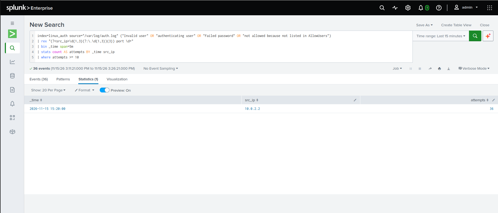
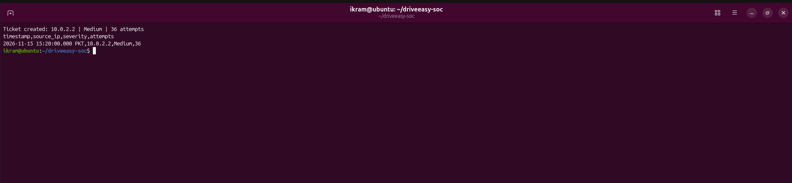

# 1. Summary

DriveEasy Rentals runs a reservation backend on Linux servers that hold customer and vehicle data. Internal audits asked for stronger host hardening and real-time detection of unauthorised access. This project hardened an Ubuntu host (Task 1), built a Splunk detection for SSH brute-force attacks (Task 2), and delivered an incident response playbook with automated ticketing (Task 3).

**Result:** the host now refuses root and password logins, allows a single named admin (`adminops`) by SSH key only, and has a default-deny firewall with only SSH open. Simulated brute-force attacks were detected by Splunk as separate incidents, and each detection was turned into a ticket by a Python script.

# 2. Environment

- Ubuntu 26.04 LTS in VirtualBox (the brief specifies 22.04; the difference is documented in Task 1).
- Admin computer: Windows, connected through a NAT port forward (`127.0.0.1:2222` to VM port 22).
- SIEM: Splunk (index `linux_auth`, source `/var/log/auth.log`).
- Framework: MITRE ATT&CK T1110 Brute Force.

# 3. Hardening results

| Control | Before | After |
|---|---|---|
| Firewall (UFW) | Inactive | Active, default deny incoming, only 22/tcp allowed |
| Root SSH login | Default setting | `PermitRootLogin no` |
| Password SSH login | Default setting (enabled) | `PasswordAuthentication no` |
| Public key login | Not configured for a dedicated admin | `PubkeyAuthentication yes`, key installed for `adminops` |
| Max auth tries | Default setting | `MaxAuthTries 3` |
| Allowed SSH users | Not restricted | `AllowUsers adminops` |
| X11 forwarding | Default setting | `X11Forwarding no` |
| Unneeded services | `avahi-daemon` (5353) and `cups` (631) listening | Disabled and masked; ports closed |
| Open ports | 22, 5353, 631 | 22 only |
| Automatic updates | Not confirmed at baseline | `unattended-upgrades` enabled and active |
| Admin account | Personal account used for administration | Non-root `adminops` in the `sudo` group |

The full before and after files are in the Task 1 repository (`before/`, `after/`, `sshd_diff.txt`).


# 4. Detection rule and results

**Saved search:** `SSH Brute Force Detected`. It matches failed, invalid and refused SSH log lines, extracts the source IP, and groups events from one IP into one attack (a gap of more than 30 seconds starts a new attack). It reports an attack at **10 or more events**.

```spl
index=linux_auth source="/var/log/auth.log"
  ("Invalid user" OR "authenticating user" OR "Failed password"
   OR "not allowed because not listed in AllowUsers")
| rex "(?<src_ip>\d{1,3}(?:\.\d{1,3}){3}) port \d+"
| where isnotnull(src_ip)
| transaction src_ip maxpause=30s
| where eventcount >= 10
| eval attempts=eventcount
| table _time src_ip attempts duration
```

Because password login is disabled, attacks do not produce `Failed password` lines. They produce `Invalid user` and `authenticating user` lines, so the search matches those too.

{width=90%}

## Detection metrics

| Metric | Value |
|---|---|
| Attack method | Loop of 30 SSH attempts with fake usernames (`fakeuser1` to `fakeuser30`), run from Windows through the port forward |
| Attempts sent per run | 30 |
| Log events matched per attack | 36 |
| Source IP seen | `10.0.2.2` (VirtualBox NAT address of the Windows host) |
| Time from attack to result in Splunk | Under 1 minute (search run about 30 seconds after each attack) |
| Detection threshold | 10 events in one attack |
| Ticket creation | Under 1 second per alert |
| False positives | None observed outside the simulated attacks |

Log events are higher than attempts sent (36 against 30) because one failed login can write more than one log line.

# 5. Incident response and automation

The playbook (`docs/playbook.md`) covers detection, triage, containment, eradication, recovery and lessons learned, mapped to MITRE ATT&CK T1110, with a severity table.

`scripts/create_ticket.py` reads the exported alert JSON and appends a row (timestamp, source IP, severity, attempt count) to `tickets.csv`. Severity bands: 10 to 49 Medium, 50 to 199 High, 200 or more Critical. It reports clear errors for a missing file, bad JSON or missing fields.

{width=90%}

**Splunk Free limitation:** Splunk Free cannot run scheduled alerts or alert actions. Detection is a saved search run on demand, and `scripts/export_alert.sh` exports the result as JSON for the ticket script. With a licence that supports alerting, the same search would run on a schedule and call the script through a webhook.

**Demo video:** <https://youtu.be/ap3mHOtiZAA>

# 6. Findings

1. **Hardening stops password brute force.** With password login disabled, guessing cannot succeed. Every attempt was refused.
2. **The remaining risk is key theft.** A stolen `adminops` private key would bypass the brute-force controls.
3. **Detection must match the hardened log format.** The first version of the search found nothing because it looked for `Failed password`, which no longer appears.
4. **Fixed time buckets can hide attacks.** Two attacks inside one 5-minute bucket merged into one result. Grouping by gaps in time keeps them separate.
5. **Manual steps remain** because Splunk Free cannot trigger the script.

# 7. Recommendations

1. Protect admin SSH keys with a passphrase or a hardware security key, and rotate them regularly. A stolen key is the main remaining risk.
2. Install fail2ban to block repeat offenders automatically at the firewall.
3. Restrict SSH to a VPN or fixed admin IP range instead of exposing port 22.
4. Add a second detection for a successful login from a new IP.
5. Use a Splunk licence with alerting so detections run on a schedule and create tickets automatically.
6. Replace the CSV with a ticketing system such as Jira, ServiceNow or TheHive.
7. Apply the same baseline to every DriveEasy Linux host and re-audit every quarter.

# 8. Conclusion

The server is now much harder to attack: root and password logins are refused, only one admin can connect, and only SSH is exposed. Splunk detects brute-force attempts within a minute, and each detection becomes a ticket that an analyst can handle by following the playbook. The remaining work is operational: automatic alerting, automatic blocking, and applying the same baseline to the other servers.
